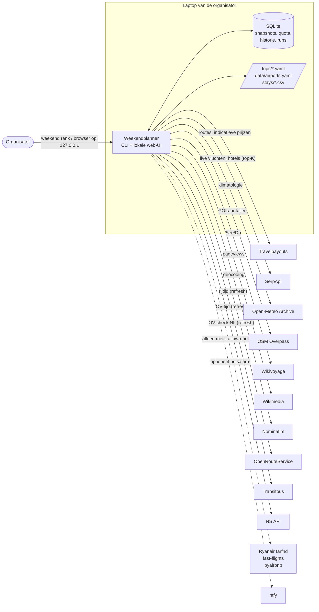
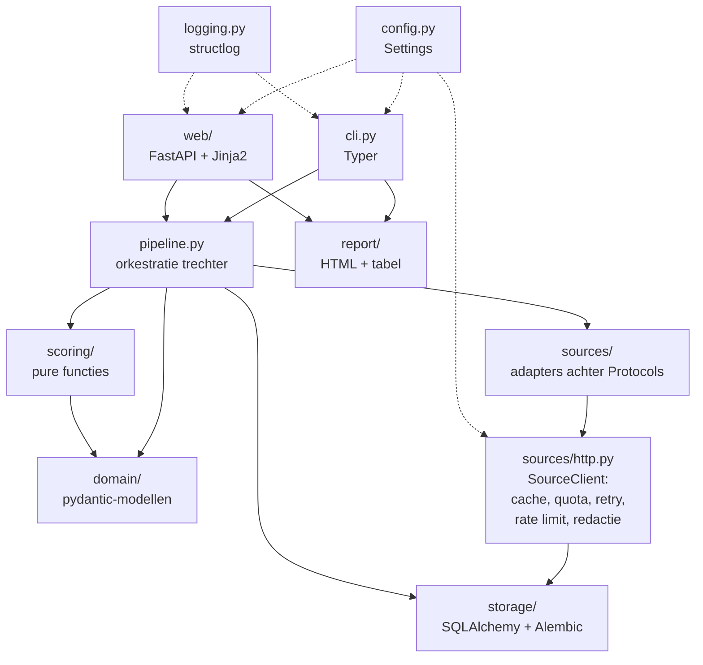
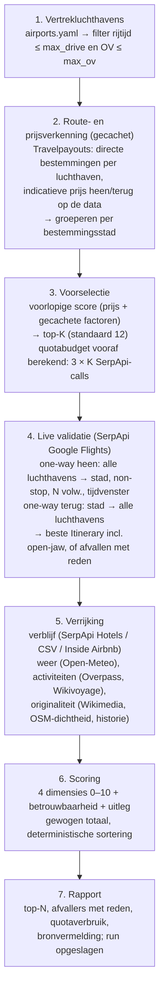
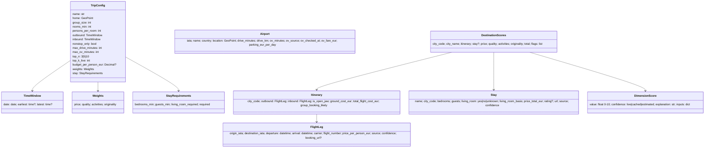
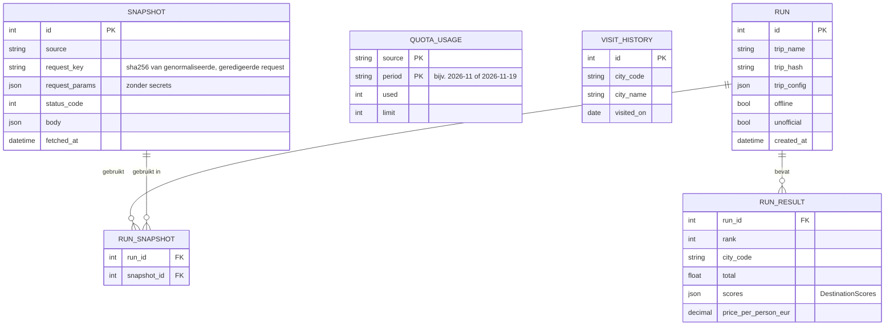

# Architectuur: Weekendplanner

Status: voorstel (2026-11-19). Bron van eisen: `docs/PROJECT_BRIEF.md` en `~/.claude/STANDARDS.md`. Beslissingen staan in `docs/adr/`.

## 1. Overzicht
Een lokale Python-tool voor één organisator. Invoer is een trip-configuratie (YAML, CLI-vlaggen of webformulier). Uitvoer is een gerangschikte top-N (3, 5 of 10) bestemmingen met per bestemming vier scores (0–10), een totaalscore, een uitleg en de betrouwbaarheid van elke score. **Vluchten zijn leidend**: zonder geschikte directe heen- én terugvlucht valt een bestemming af.

Kernprincipes:
- **Trechter** (ADR-0003): breed met gecachte data, smal en live alleen voor de top-K.
- **Pure scoring**: alle rekenregels zijn pure functies zonder I/O; de pipeline levert ze data aan.
- **Snapshot-first**: elke externe response wordt opgeslagen; met `--offline` rekent de tool deterministisch opnieuw zonder netwerk.
- **Quotum nooit stil overschreden**: waarschuwing bij 80%, harde stop bij 100%.

## 2. Context



## 3. Componenten



| Component | Verantwoordelijkheid |
|---|---|
| `config.py` | `Settings` (pydantic-settings). **De enige plek die de omgeving/`.env` leest.** Valideert bij het opstarten (OB-3). |
| `domain/` | Pydantic-modellen (§5) en domeinfouten. Geen I/O. |
| `sources/` | Eén adapter per bron. Valideert responses met pydantic aan de grens (SE-4). Alle HTTP via `SourceClient`. |
| `sources/http.py` | `SourceClient`: httpx met timeouts, User-Agent `weekendplanner/<versie> (+CONTACT_URL)`, cache-lookup in snapshots, quota-check vóór elk verzoek, retry met backoff op 429/5xx (max 3), rate limit per bron (Nominatim 1/s), redactie van secrets uit URL's en params vóór loggen en opslaan. |
| `storage/` | SQLAlchemy-modellen, sessies, repositories voor snapshots, quota, historie en runs. Migraties in `alembic/`. |
| `scoring/` | Pure functies per dimensie, normalisatie, weging, top-N, uitlegteksten, betrouwbaarheid. |
| `pipeline.py` | Voert de trechter uit (§4), verzamelt afvallers met reden, levert een `RankingResult`. |
| `cli.py` | Typer-app `weekend`: `--version`, `trip check`, `rank`, `history add/list`, `airports refresh/list`, `stays import`, `watch`, `snapshots prune`, `serve`, `quota`. |
| `web/` | FastAPI-app: `GET /health`, `GET /` (formulier), `POST /rank`, `GET /runs/{id}`. Security-middleware (ADR-0005). |
| `report/` | Rendert `RankingResult` naar terminaltabel en HTML (gedeelde Jinja2-templates met de web-UI). |

Elke adapter implementeert een Protocol per soort bron, zodat de pipeline officiële en onofficiële bronnen gelijk behandelt:

| Protocol | Officieel | Onofficieel (ADR-0004) |
|---|---|---|
| `RoutePriceSource` | `travelpayouts` | `ryanair` |
| `LiveFlightSource` | `serpapi_flights` | `fast_flights` |
| `StaySource` | `serpapi_hotels`, `stays_csv`, `inside_airbnb` | `pyairbnb` |
| `ClimateSource` | `open_meteo` | – |
| `ActivitySource` | `overpass`, `wikivoyage` | – |
| `PopularitySource` | `wikimedia`, `overpass` (dichtheid) | – |
| `Geocoder` | `nominatim` | – |
| `TravelTimeSource` | `ors`, `ns` | – |

## 4. Ranking-pipeline (trechter)



Regels:
- **Afvallen** (met reden in het rapport): geen directe heenvlucht in het venster, geen directe terugvlucht in het venster, geen verblijf dat aan de harde eisen voldoet (alleen als `stay.required: true`), budget overschreden. "Geen resultaten" op een retourdatum wordt gemeld als *mogelijk nog niet in verkoop*.
- **Bron faalt** (fout, quotum op): de pipeline gaat door. Vluchten blijven dan op *gecachet* (Travelpayouts) en de bestemming krijgt het label "niet live bevestigd"; andere dimensies vallen terug op een schatting met betrouwbaarheid *geschat*. Nooit stil: elke terugval staat in log en rapport (OB-1).
- **Offline** (`--offline`): `SourceClient` gebruikt alleen snapshots; een ontbrekende snapshot telt als "bron faalt".
- **Itinerary**: per stad (meerdere luchthavens per stad mogelijk, bijv. MIL) de goedkoopste geldige combinatie van één heen- en één terugvlucht, ook via verschillende NL/DE/BE-luchthavens. Kosten voor de groep = (heen + terug) × N + grondvervoer. Grondvervoer: zelfde luchthaven heen en terug → auto (`drive_km × eur_per_km × ⌈N/seats_per_car⌉` + parkeren); verschillende luchthavens → OV-tarief × N × 2. Vlag `group_booking_likely` als N ≥ 10 en de maatschappij in `group_booking_airlines` (config, bijv. KL).

## 5. Datamodel

### Domeinmodellen (pydantic, `src/app/domain/`)



`Confidence` is een geordende enum `live > cached > estimated`. De betrouwbaarheid van een dimensie is de laagste van de gebruikte invoer.

### Opslag (SQLite, `src/app/storage/`)



Statische data in git: `data/airports.yaml` (luchthavens, rij- en OV-tijden met bron en controledatum), `trips/*.yaml` (trip-configs; zie open punt ADR-0006 bij een publieke repo). Verblijf-CSV's staan in `stays/` (gitignored).

## 6. Scoring (`src/app/scoring/`)
Alle constanten staan in één `ScoringParams`-model met defaults; overschrijfbaar in de trip-YAML. `lin(x, a, b)` = lineair van 0 (bij `a`) naar 10 (bij `b`), begrensd op [0, 10]. Elke functie geeft een `DimensionScore` met een Nederlandse uitlegzin, bijv. *"Prijs 7,4: € 412 p.p. (vlucht € 188, verblijf € 196, vervoer € 28); vluchten live, verblijf geschat."*

| Dimensie | Formule (defaults) |
|---|---|
| **Prijs** | `p` = (vlucht heen+terug + verblijf/N + grondvervoer/N) per persoon. `price = lin(p, high, low)` met `low = 250`, `high = budget_per_person_eur` of `750`. |
| **Kwaliteit** | `0,40·flight + 0,35·weather + 0,25·stay`. *flight*: gemiddelde van vertrektijd-gemak (10 midden in het venster, −2 per uur afwijking), vliegduur (`lin(min, 240, 90)`) en reistijd naar luchthaven (`lin(min, max_drive, 45)`). *weather*: `0,4·lin(Tmax, 5, 18) + 0,3·lin(zon_uren, 0, 8) + 0,3·lin(regendagen_fractie, 0,6, 0)` (regendag ≥ 1 mm), mediaan over 30 jaar. *stay*: 10 als alle eisen bevestigd, 7 bij woonkamer via heuristiek, 5 bij onbekend, plus `rating`-correctie ±1; geschat verblijf geeft betrouwbaarheid *geschat*. |
| **Activiteiten** | Per categorie *c* (musea, bezienswaardigheden, uitgaan, eten, escape rooms, natuur, sport/water, markten): `s_c = 10 · min(1, ln(1+n_c)/ln(1+sat_c))`. `amount` = gemiddelde `s_c`; `variety` = 10 · aandeel categorieën met `n_c ≥ 3`. `activities = 0,6·amount + 0,4·variety`; +0,5 (max 10) als Wikivoyage ≥ 15 See/Do-items heeft. |
| **Originaliteit** | `fame = lin(log10(gem. maandelijkse pageviews), 6, 4)`; `density = lin(toerisme-POI per km², 50, 5)`; `base = 0,6·fame + 0,4·density`; `history_penalty` per eerder bezoek: 4 (< 2 jaar), 2 (2–5 jaar), 1 (> 5 jaar), totaal max 6. `originality = max(0, base − penalty)`. |
| **Totaal** | `Σ w_i · s_i / Σ w_i`, defaults `price 0,35 · quality 0,30 · activities 0,20 · originality 0,15`. Gewichten ≥ 0, som > 0 (gevalideerd). |

Ontbrekende invoer: score 5,0, betrouwbaarheid *geschat*, uitleg "geen data: …". **Sortering**: totaal aflopend, dan prijs aflopend, dan `city_code` oplopend, zodat dezelfde snapshot en gewichten altijd dezelfde ranking geven. Afronding alleen bij weergave (1 decimaal).

Uitwerkingen die de formules niet vastleggen (T-003):
- **Vertrektijden in lokale tijd:** vertrekgemak gebruikt de kloktijd in de tijdzone die in de data staat. Bronadapters moeten vluchttijden dus leveren met de lokale offset van de luchthaven.
- **Half-open venster:** het ideaal ligt `open_window_ideal_offset_hours` (standaard 3) na de begintijd of vóór de eindtijd. Bij "na 15:00" is het ideaal dus 18:00. Een venster zonder grenzen geeft altijd 10.
- **Verblijf:**
  - te weinig slaapkamers of gasten voor de groep geeft 0;
  - woonkamer `confirmed` geeft 10, `likely` 7 en `unknown` 5;
  - woonkamer `absent` geeft 0 als een woonkamer vereist is, anders 5;
  - een beoordeling van 9 of hoger geeft +1, lager dan 7 geeft −1.
- **Prijs zonder verblijf:** geschat op 5,0 met de vlag `no_stay`. Een budget kleiner dan of gelijk aan `price_low_eur` wordt opgehoogd tot net daarboven.
- **Vlaggen:** `open_jaw`, `group_booking`, `no_stay`, `over_budget`.
- **Parameters per trip:** alle constanten staan in `ScoringParams` en zijn per trip te overschrijven onder `scoring:` in de trip-YAML. Een onbekende sleutel geeft een fout.

## 7. Quota en snapshots
- **Limieten** in `Settings` met defaults: `SERPAPI_MONTHLY_LIMIT=250` (gedeeld door flights en hotels, periode = kalendermaand UTC), Travelpayouts/ORS/NS als dag- of minuutlimiet volgens hun voorwaarden, onofficieel max. 30 per run.
- **Vóór elk netwerkverzoek**: cache-hit binnen TTL → geen verzoek. Anders atomair `used + 1` als `used < limit`, anders `QuotaExceededError` (harde stop voor die bron). Bij ≥ 80% één `quota_warning`-log en een melding in rapport/UI.
- **Budget vooraf**: de pipeline schat het aantal SerpApi-calls (3 × K) en stopt vóór stap 4 als het resterende quotum te klein is; de CLI biedt `--top-k` om te verkleinen. `weekend quota` toont het verbruik.
- **Snapshots**: elke response (ook foutresponses) wordt opgeslagen met bron, geredigeerde request, status en tijdstip. Een run legt vast welke snapshots hij gebruikte (`RUN_SNAPSHOT`), zodat `weekend rank --offline --run <id>` exact reproduceert.
- **Bewaartermijn**: `SNAPSHOT_RETENTION_MONTHS=12`; `weekend snapshots prune` verwijdert ouder (vraagt bevestiging, `--yes` voor de taakplanner). Snapshots die aan een bewaarde run hangen worden pas met die run verwijderd.

## 8. Foutafhandeling, logging en security
- **Fouten**: domeinfouten in `domain/errors.py` (`ConfigError`, `TripValidationError`, `SourceError(source, retryable)`, `QuotaExceededError`, `OfflineMissError`). Geen blind `except`. CLI vangt domeinfouten af tot een leesbare melding en exitcode ≠ 0; onverwachte fouten worden gelogd met context en geven exitcode 1, zonder stacktrace voor de gebruiker (behalve met `--debug`). Web: exception handler rendert een foutpagina zonder stacktrace (OB-1).
- **Logging**: structlog naar stderr; `LOG_FORMAT=json` (standaard) of `console`; `LOG_LEVEL`. Een `run_id` (CLI) of `request_id` (web) wordt via contextvars aan elke regel gekoppeld (OB-5). De redactie-processor `SecretRedactor` (`src/app/logging.py`) haalt geheimen weg op drie manieren:
  - **Op naam:** veldnamen, ook in geneste dicts, lijsten en (naam, waarde)-paren, en camelCase. Een naam is geheim als een segment `token`, `secret`, `password`, `authorization`, `cookie`, `credential` enzovoort is. Een `key`-segment telt ook, tenzij het een gewone identifier is (`request_key`, `cache_key`, `public_key`).
  - **Op patroon in tekst:** dezelfde naamregels voor `naam=waarde`, `naam: waarde` en `"naam": "waarde"`, plus Authorization- en Cookie-headers, `Bearer`/`Basic`-credentials en `user:wachtwoord@` in URL's. Tracebacks worden eerst tekst (`format_exc_info`) en daarna ook gescrubd.
  - **Op exacte waarde:** de echte API-sleutels uit `Settings` (`known_secrets`), zodat ook onverwachte formaten worden weggepoetst.

  De `httpx`/`httpcore`-loggers staan op WARNING, omdat ze via de stdlib-logging volledige URL's loggen buiten de processor om (SerpApi zet de key in de query). Geen persoonsgegevens (de tool verwerkt er geen).
- **Configuratie** (`.env.example`, zonder waarden): `SERPAPI_KEY`, `TRAVELPAYOUTS_TOKEN`, `NS_API_KEY`, `ORS_API_KEY` (optioneel bij opstarten, formaat gevalideerd als aanwezig; een bron zonder key meldt "niet geconfigureerd" bij gebruik), `CONTACT_URL` (verplicht, https-URL, geen e-mailadres), `DATABASE_URL`, `LOG_LEVEL`, `LOG_FORMAT`, `SNAPSHOT_RETENTION_MONTHS`, `SERPAPI_MONTHLY_LIMIT`; later `NTFY_TOPIC` (T-015). Secrets zijn `SecretStr`.
- **Web**: zie ADR-0005 (127.0.0.1, TrustedHost, CSRF, CSP, autoescape).
- **Supply chain**: lockfile, `pip-audit`, gitleaks, Dependabot (uv + github-actions), Actions vastgepind op SHA (SE-10), `permissions: contents: read` op workflow-niveau.

## 9. Bronvermelding en licenties
Rapport en UI tonen onderaan altijd: "© OpenStreetMap-bijdragers (ODbL)", "Weerdata: Open-Meteo.com (CC BY 4.0)", "Wikivoyage/Wikipedia (CC BY-SA 4.0)", "Inside Airbnb (CC BY 4.0)" (indien gebruikt), "© openrouteservice.org by HeiGIT" (rijtijden), plus "Prijzen via Travelpayouts/Aviasales en Google via SerpApi; indicatief, geen boeking". Onofficiële bronnen krijgen een waarschuwingsblok. De attributies staan in één `ATTRIBUTIONS`-constante die door report en web wordt gebruikt.

## 10. Mappenstructuur

```text
.
├── .github/
│   ├── workflows/ci.yml             # format, lint, typecheck, test, build, gitleaks, pip-audit, e2e → ci
│   ├── workflows/release-please.yml
│   ├── dependabot.yml
│   └── CODEOWNERS                   # optioneel
├── alembic/                         # env.py + versions/
├── data/airports.yaml
├── trips/maart-2027.yaml
├── docs/ (PROJECT_BRIEF.md, ARCHITECTURE.md, PLAN.md, adr/)
├── src/app/
│   ├── __init__.py                  # __version__
│   ├── config.py                    # Settings: enige lezer van de omgeving
│   ├── logging.py
│   ├── cli.py                       # Typer-app "weekend"
│   ├── pipeline.py
│   ├── domain/ (trip.py, flights.py, stays.py, scores.py, errors.py)
│   ├── scoring/ (price.py, quality.py, weather.py, activities.py, originality.py, ranking.py, params.py)
│   ├── sources/
│   │   ├── base.py                  # Protocols
│   │   ├── http.py                  # SourceClient
│   │   ├── travelpayouts.py, serpapi_flights.py, serpapi_hotels.py, stays_csv.py,
│   │   │   inside_airbnb.py, open_meteo.py, overpass.py, wikivoyage.py, wikimedia.py,
│   │   │   nominatim.py, ors.py, ns.py
│   │   └── plugins.py (loader voor plugins/local/, alleen met --allow-unofficial)
│   ├── storage/ (db.py, models.py, snapshots.py, quota.py, history.py, runs.py)
│   ├── report/ (table.py, html.py, attributions.py)
│   └── web/ (app.py, security.py, routes.py, templates/, static/)
├── tests/
│   ├── unit/                        # scoring, domain, adapters (respx + opgenomen fixtures)
│   ├── integration/                 # echte SQLite + alembic, pipeline op fixture-snapshots
│   ├── e2e/                         # Playwright + axe, CLI end-to-end offline
│   └── fixtures/                    # opgenomen API-responses (zonder secrets)
├── .env.example, .gitignore, .pre-commit-config.yaml, pyproject.toml, uv.lock
├── release-please-config.json, .release-please-manifest.json
└── README.md, SECURITY.md, CHANGELOG.md (door release-please)
```

## 11. Teststrategie
- **Unit** (meeste): scoring, domeinvalidatie, adapter-parsing tegen opgenomen responses met `respx`; tijd via geïnjecteerde `Clock`.
- **Integratie**: echte SQLite in `tmp_path` met `alembic upgrade head` (ADR-0002); pipeline end-to-end op fixture-snapshots in offline-modus.
- **E2E**: `weekend rank … --offline` op fixtures (deterministische ranking); Playwright-formulierflow met axe-scan zonder overtredingen.
- Netwerk geblokkeerd in alle tests (`pytest-socket`), behalve localhost voor de e2e-server.
